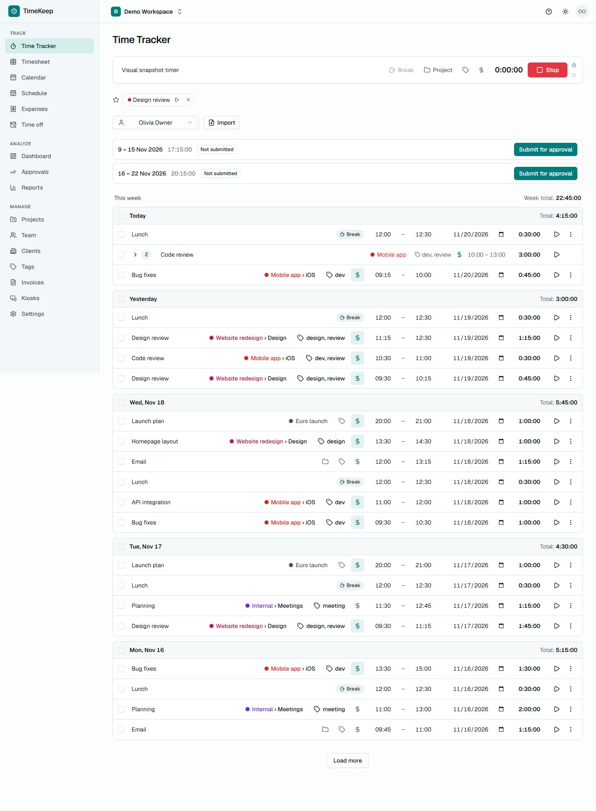
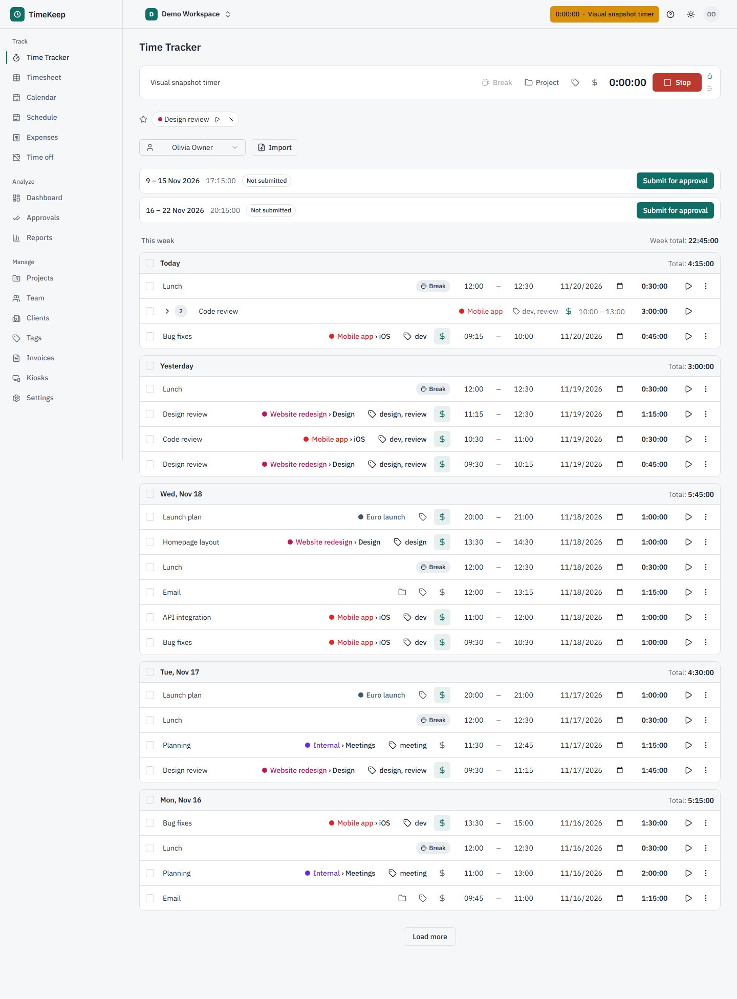
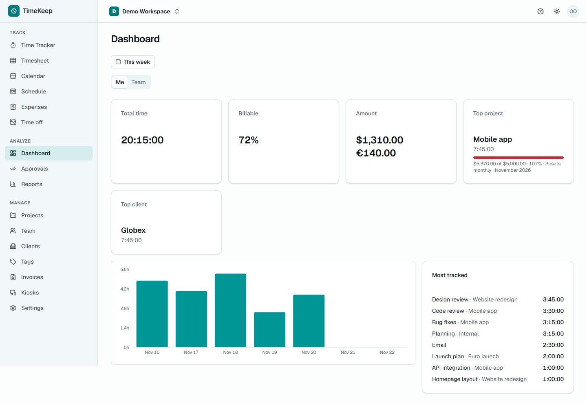
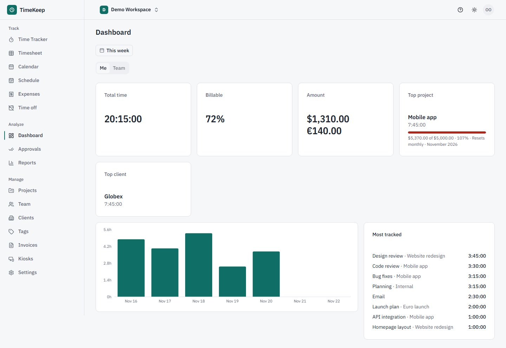
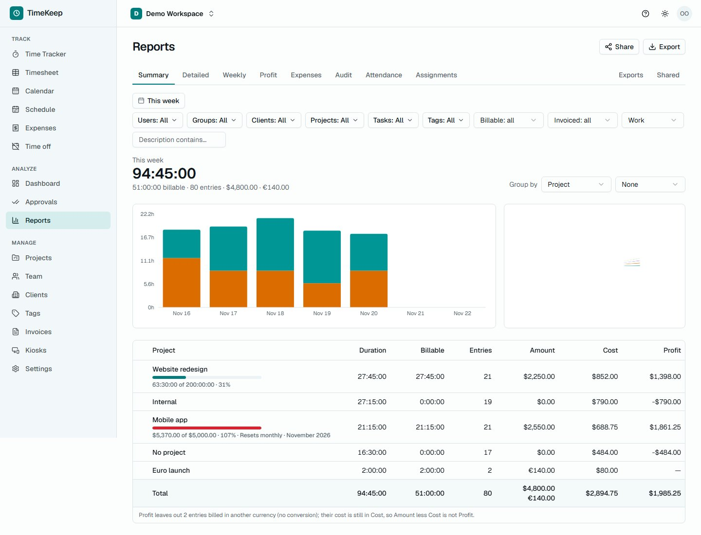
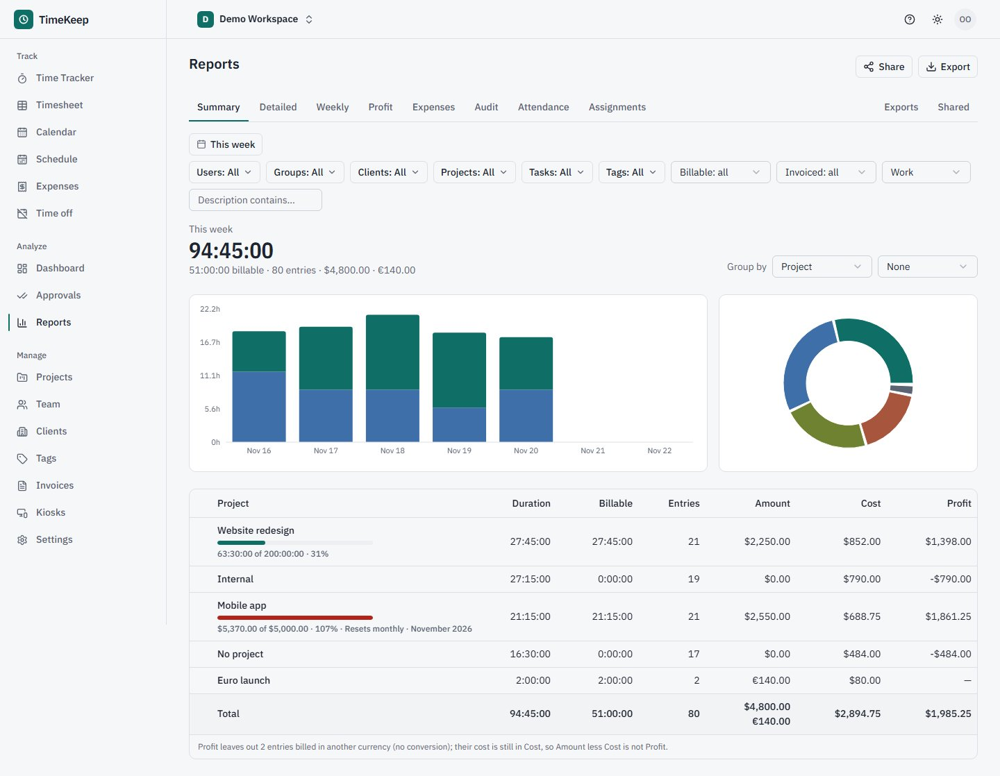
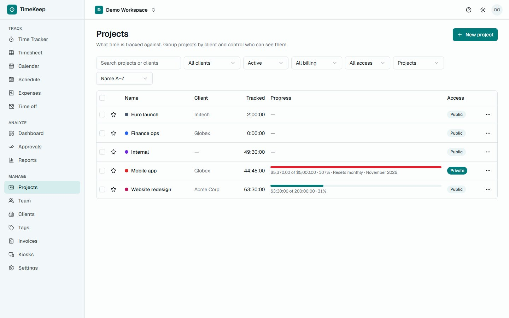
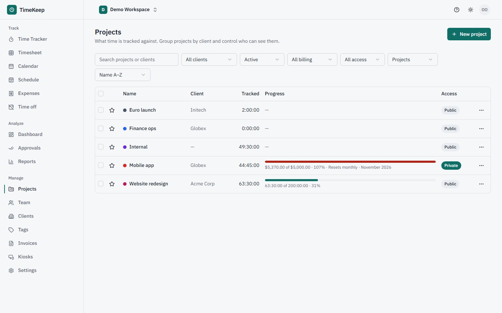
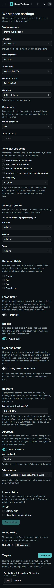
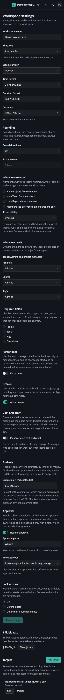

# TimeKeep UI

How TimeKeep looks, and the rules that keep it that way. The theme is in `packages/ui/src/styles/globals.css`; the rules below are checked by tests, named with each rule.

## The idea

TimeKeep takes its look from punch clocks and time cards: cool paper, ink, one working colour, and figures that line up. One element is allowed to be bold, the running timer. Everything else is quiet: a border and space separate regions, there are no shadows on the page, and colour means something or is not there.

## Colour

Token names follow shadcn/ui, so its components work unchanged. Values are hex (or `rgba()`), so the contrast check can read them.

| Token | Light | Dark | What it is for |
| --- | --- | --- | --- |
| `background` | `#F6F7F9` | `#12161C` | the page |
| `card` | `#FFFFFF` | `#181D24` | a framed region |
| `popover` | `#FFFFFF` | `#1C222A` | what floats |
| `foreground` | `#1E2430` | `#E6E9EE` | text |
| `muted-foreground` | `#5B6472` | `#A3ABB7` | secondary text |
| `muted` / `secondary` | `#EDEFF2` / `#E9ECF0` | `#20262E` / `#242B34` | quiet fills |
| `accent` | `#E3F0EE` | `#1E3331` | hover and selection |
| `border` | `#DCE0E6` | `rgba(255,255,255,0.09)` | the one line between regions |
| `primary`, `ring` | `#0F6E66` | `#3FB8AC` | what the person can act on; the focus ring |
| `primary-foreground` | `#FFFFFF` | `#0B1F1D` | text on the primary |
| `destructive` | `#B42318` | `#F0776A` | deleting, errors |
| `live` | `#D9910B` | `#F0B23A` | time is running (see below) |
| `live-foreground` | `#1E1400` | `#2A1C00` | text on `live` |
| `live-line` | `#B07400` | `#F0B23A` | the same amber as a thin line |
| `chart-1` … `chart-5` | `#0F6E66` `#3E6FA8` `#6F8231` `#A8553D` `#5B6472` | `#3FB8AC` `#6FA3DB` `#A9BC62` `#E08A6E` `#9AA4B2` | the primary, steel, olive, brick, slate |

Charts never use amber, purple or pink: amber is taken, and a chart is never "live".

### Contrast

`pnpm contrast:check` (`scripts/check-contrast.mts`, a CI step) reads the tokens and fails under WCAG AA: 18 text pairs at 4.5:1 and 9 graphic pairs at 3:1, in both themes. Some of what it prints:

| Pair | Light | Dark |
| --- | --- | --- |
| text on the page | 14.51:1 | 14.91:1 |
| secondary text on the page / on a card | 5.58:1 / 5.98:1 | 7.83:1 / 7.31:1 |
| primary on the page / on a card | 5.69:1 / 6.10:1 | 7.49:1 / 6.99:1 |
| text on the primary | 6.10:1 | 7.05:1 |
| text on `live` | 6.93:1 | 8.80:1 |
| `live-line` on the page / on a card | 3.67:1 / 3.93:1 | 9.62:1 / 8.98:1 |

A new token pair that carries text goes into the script's list.

## The live colour

`--live` means **time is running**, and nothing else. It appears in exactly these places:

- the running timer: the timer bar (`components/tracker/timer-bar.tsx`) and the chip in the top bar (`components/shell/timer-chip.tsx`);
- the calendar's now-line (`components/calendar/now-line.tsx`), as `live-line`;
- the dot beside "Tracking now" on Team activity (`components/dashboard/live-dot.tsx`).

`apps/web/src/live-token.test.ts` fails on a use anywhere else. A second meaning would cost the colour its first, so to add a place, change this list first, then the test's.

`live` is a fill with `live-foreground` text on it; amber text on a light surface does not pass contrast, which is why the dot's label is ink. `live-line` is the amber darkened for the light theme, so a 2px line clears 3:1.

## Type

IBM Plex Sans (400, 500, 600) for the interface, and IBM Plex Sans Condensed (600) as `font-display` for clocks and totals, both through `next/font/google`. In both, every digit has one width, so a ticking timer and a column of totals do not shift.

The scale is closed. These are the only sizes; Tailwind's other names (`text-lg`, `text-3xl`, …) are cleared in the theme and generate nothing.

| Class | Size | Line height | Used for |
| --- | --- | --- | --- |
| `text-xs` | 12 | 1.5 | labels, captions; nothing is smaller |
| `text-meta` | 13 | 1.5 | secondary lines, the timer chip |
| `text-sm` | 14 | 1.5 | body: tables, forms, menus |
| `text-base` | 16 | 1.5 | section and dialog headings (600) |
| `text-xl` | 20 | 1.2 | page titles (600) |
| `text-2xl` | 28 | 1.2 | dashboard figures |
| `text-display` | 32 | 1.2 | report totals, in `font-display` |
| `text-display-lg` | 48 | 1.1 | the running clock, in `font-display` |

`apps/web/src/ui-scale.test.ts` fails on a size class outside the scale, or a pixel size, in `apps/web/src` or `packages/ui/src`.

## Radius and depth

- 6px on controls (`rounded-md`), 10px on what floats or frames a region (`rounded-lg`, `rounded-xl`: dialogs, popovers, menus, cards), 4px on small marks. Table rows have none.
- Shadows only on what floats: popovers, menus, tooltips, dialogs, sheets, and the tracker's two floating layers. Bars, cards and controls are separated by a border and space. The same test fails on a shadow class anywhere else.

## Layout

- The sidebar's section labels are sentence case, 12/500, muted. An item is muted until it is the page: then ink text with a 2px primary bar on its left edge, never a filled pill.
- Content starts at the sidebar's edge with one 32px gutter (16px under 768px) and stops at 1200px. It is not centred in what is left: the eye has one left edge to return to.
- A page of wide tables takes the full width: `<PageHeader wide>` (reports, timesheet, team, the schedule grid).
- `PageHeader` (`components/page-header.tsx`) is the head of every workspace page: the title at 20/600, at most one line saying what the page is for, actions on the right (under the title on a phone). `mark` and `meta` sit beside the title, outside the heading. Pages do not write their own `h1`.
- While a timer runs, the top bar shows an amber chip with its clock and description on every page; it opens the tracker.

## Empty states

`EmptyState` (`components/empty-state.tsx`) is for a page's main list when it has nothing: a title that says what to do, one line of why, and a primary button that does it. No icon.

| Page | Title | Button |
| --- | --- | --- |
| Tracker | Track your first entry | Start timer (puts the cursor in the description) |
| Projects | Create a project | Create project |
| Clients | Add a client | Add client |
| Tags | Create a tag | Create tag |
| Invoices | Create an invoice | Create invoice |
| Kiosks | Add a kiosk | Add kiosk |
| Tasks | Add a task | Add first task |
| Groups | Create a group | Create group |

Someone who may not create sees the title as a statement ("No projects yet") and no button. A filter that matches nothing, and a small note inside a card or a dialog, are one line of muted text (`EmptyNote`). Copy is sentence case.

## The floor

Checked by `apps/web/e2e/ui-floor.spec.ts`:

- **Focus:** whatever the keyboard reaches shows a 2px outline in the ring colour, 2px off the element. One rule in the theme, outside any CSS layer, so no component can switch it off.
- **Motion:** with "reduce motion" on, animations and transitions end at once.
- **Width:** no main page scrolls sideways at 375px; a wide table scrolls inside its own frame.

## Before and after

`pnpm e2e:visual` saves full-page screenshots of fifteen screens at 1440 and 375 wide, in light and dark, into `apps/web/e2e/visual/__screenshots__/<set>/` (`VISUAL_SET=before` or `after`; JPEG at quality 85). They are for people to compare, not a pixel test. The `before` set is the app on 2026-11-20, ahead of this refresh.

### Tracker, a timer running

| Before | After |
| --- | --- |
|  |  |

### Dashboard

| Before | After |
| --- | --- |
|  |  |

### Reports, Summary

| Before | After |
| --- | --- |
|  |  |

### Projects

| Before | After |
| --- | --- |
|  |  |

### Settings, on a phone in dark

| Before | After |
| --- | --- |
|  |  |
